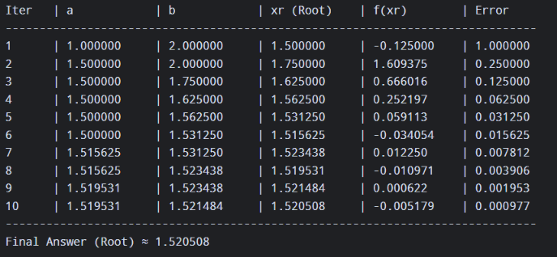
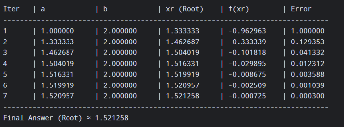
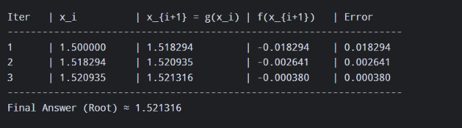
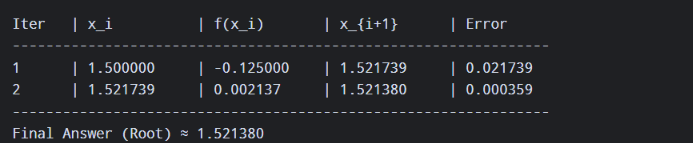
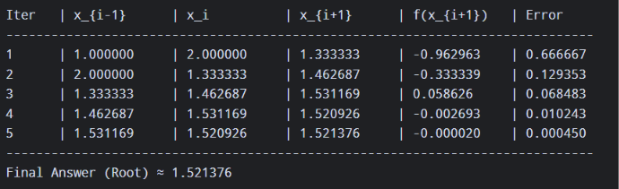

# Nonlinear Equation Solver in Python

## 1. Project Overview

This project provides a command-line program built in Python to find the roots of nonlinear equations of the form $f(x) = 0$. The user can dynamically enter any mathematical function and choose from five classical numerical methods. For each selected method, the program generates a formatted step-by-step iteration table showing intermediate values, errors, and the final approximate root.
## -- Github Repository
[Repository](https://github.com/eng-mahmoud-awad/Numircal-Methods)
## 2. Supported Numerical Methods

### 2.1 Bisection Method

A bracketing method that repeatedly bisects an interval $[a, b]$ where $f(a) \cdot f(b) < 0$:

$$
x_r = \frac{a + b}{2}
$$

### 2.2 False Position Method (Regula Falsi)

A bracketing method that uses a secant line between $(a, f(a))$ and $(b, f(b))$ to find the root approximation:

$$
x_r = \frac{a \cdot f(b) - b \cdot f(a)}{f(b) - f(a)}
$$

### 2.3 Fixed-Point Iteration Method

An open method where the equation $f(x) = 0$ is algebraically rewritten in the form $x = g(x)$, and iterations follow:

$$
x_{i+1} = g(x_i)
$$

### 2.4 Newton-Raphson Method

An open method that uses the function and its first derivative $f'(x)$ to converge rapidly toward the root:

$$
x_{i+1} = x_i - \frac{f(x_i)}{f'(x_i)}
$$

### 2.5 Secant Method

An open method that approximates the derivative using two previous guesses $x_{i-1}$ and $x_i$:

$$
x_{i+1} = x_i - \frac{f(x_i) \cdot (x_i - x_{i-1})}{f(x_i) - f(x_{i-1})}
$$

## 3. How to Run the Program

1. Ensure **Python 3.x** is installed on your computer.

2. Open the project folder in **Visual Studio Code**.

3. Open `numerical_methods.py` and click the **Run (Play)** button in the top-right corner, or run the following command in the terminal:

   ```
   python main.py
   
   ```

4. Follow the on-screen prompts to enter your function, tolerance, maximum iterations, and initial guesses.

## 4. Python Source Code (`numerical_methods.py`)

```
from math import *

# Function to evaluate the user's mathematical expression at a given x
def evaluate(func_str, x):
    return eval(func_str)

# Numerical derivative for Newton-Raphson: f'(x) = (f(x+h) - f(x)) / h
def derivative(func_str, x, h=1e-6):
    return (evaluate(func_str, x + h) - evaluate(func_str, x)) / h

def main():
    print("=== Nonlinear Equation Solver ===")
    print("Tip: You can use x^2 or x**2, sin(x), cos(x), exp(x), log(x), sqrt(x)")
    
    eq_input = input("\nEnter f(x) = ").replace('^', '**')
    
    print("\nSelect a Numerical Method:")
    print("1. Bisection Method")
    print("2. False Position Method")
    print("3. Fixed-Point Iteration Method")
    print("4. Newton-Raphson Method")
    print("5. Secant Method")
    
    choice = input("\nEnter choice (1-5): ").strip()
    tol = float(input("Enter tolerance (e.g., 0.0001): "))
    max_iter = int(input("Enter maximum iterations (e.g., 50): "))
    print()

    # 1. BISECTION & 2. FALSE POSITION METHODS
    if choice in ['1', '2']:
        a = float(input("Enter lower guess (a): "))
        b = float(input("Enter upper guess (b): "))
        
        if evaluate(eq_input, a) * evaluate(eq_input, b) >= 0:
            print("\nError: f(a) and f(b) must have opposite signs!")
            return

        print(f"\n{'Iter':<6} | {'a':<12} | {'b':<12} | {'xr (Root)':<12} | {'f(xr)':<12} | {'Error':<12}")
        print("-" * 78)
        
        xr_old = a
        for i in range(1, max_iter + 1):
            fa = evaluate(eq_input, a)
            fb = evaluate(eq_input, b)
            
            if choice == '1':
                xr = (a + b) / 2.0
            else:
                xr = (a * fb - b * fa) / (fb - fa)
                
            fxr = evaluate(eq_input, xr)
            error = abs(xr - xr_old) if i > 1 else abs(b - a)
            
            print(f"{i:<6} | {a:<12.6f} | {b:<12.6f} | {xr:<12.6f} | {fxr:<12.6f} | {error:<12.6f}")
            
            if abs(fxr) < 1e-12 or (i > 1 and error < tol):
                break
                
            if fa * fxr < 0:
                b = xr
            else:
                a = xr
            xr_old = xr
            
        print("-" * 78)
        print(f"Final Answer (Root) = {xr:.6f}")

    # 3. FIXED-POINT ITERATION METHOD
    elif choice == '3':
        print("Rewrite f(x) = 0 in the form x = g(x)")
        g_input = input("Enter g(x) = ").replace('^', '**')
        x0 = float(input("Enter initial guess (x0): "))
        
        print(f"\n{'Iter':<6} | {'x_i':<12} | {'x_{i+1} = g(x_i)':<16} | {'f(x_{i+1})':<12} | {'Error':<12}")
        print("-" * 68)
        
        for i in range(1, max_iter + 1):
            x1 = evaluate(g_input, x0)
            fx1 = evaluate(eq_input, x1)
            error = abs(x1 - x0)
            
            print(f"{i:<6} | {x0:<12.6f} | {x1:<16.6f} | {fx1:<12.6f} | {error:<12.6f}")
            
            if error < tol:
                break
            x0 = x1
            
        print("-" * 68)
        print(f"Final Answer (Root) = {x1:.6f}")

    # 4. NEWTON-RAPHSON METHOD
    elif choice == '4':
        x0 = float(input("Enter initial guess (x0): "))
        
        print(f"\n{'Iter':<6} | {'x_i':<12} | {'f(x_i)':<12} | {'x_{i+1}':<12} | {'Error':<12}")
        print("-" * 64)
        
        for i in range(1, max_iter + 1):
            fx = evaluate(eq_input, x0)
            dfx = derivative(eq_input, x0)
            
            if abs(dfx) < 1e-12:
                print("Error: Derivative is zero. Cannot divide by zero.")
                return
                
            x1 = x0 - (fx / dfx)
            error = abs(x1 - x0)
            
            print(f"{i:<6} | {x0:<12.6f} | {fx:<12.6f} | {x1:<12.6f} | {error:<12.6f}")
            
            if error < tol:
                break
            x0 = x1
            
        print("-" * 64)
        print(f"Final Answer (Root) = {x1:.6f}")

    # 5. SECANT METHOD
    elif choice == '5':
        x0 = float(input("Enter first guess (x0): "))
        x1 = float(input("Enter second guess (x1): "))
        
        print(f"\n{'Iter':<6} | {'x_{i-1}':<12} | {'x_i':<12} | {'x_{i+1}':<12} | {'f(x_{i+1})':<12} | {'Error':<12}")
        print("-" * 78)
        
        for i in range(1, max_iter + 1):
            fx0 = evaluate(eq_input, x0)
            fx1 = evaluate(eq_input, x1)
            
            if abs(fx1 - fx0) < 1e-12:
                print("Error: Division by zero in Secant formula.")
                return
                
            x2 = x1 - fx1 * (x1 - x0) / (fx1 - fx0)
            fx2 = evaluate(eq_input, x2)
            error = abs(x2 - x1)
            
            print(f"{i:<6} | {x0:<12.6f} | {x1:<12.6f} | {x2:<12.6f} | {fx2:<12.6f} | {error:<12.6f}")
            
            if error < tol:
                break
            x0, x1 = x1, x2
            
        print("-" * 78)
        print(f"Final Answer (Root) = {x2:.6f}")

    else:
        print("Invalid choice! Please select a number between 1 and 5.")

if __name__ == "__main__":
    main()

```

## 5. Program Output & Screenshots

Below are the test results for solving the nonlinear equation:

$$
f(x) = x^3 - x - 2 = 0
$$


with a tolerance of $0.0001$ and a maximum of $50$ iterations.


### 5.1 Bisection Method Output

* **Inputs:** $a = 1$, $b = 2$

* **Screenshot:**


### 5.2 False Position Method Output

* **Inputs:** $a = 1$, $b = 2$

* **Screenshot:**



### 5.3 Fixed-Point Iteration Method Output

* **Inputs:** $g(x) = (x + 2)^{(1/3)}$, $x_0 = 1.5$

* **Screenshot:**



### 5.4 Newton-Raphson Method Output

* **Inputs:** $x_0 = 1.5$

* **Screenshot:**



### 5.5 Secant Method Output

* **Inputs:** $x_0 = 1$, $x_1 = 2$

* **Screenshot:**

